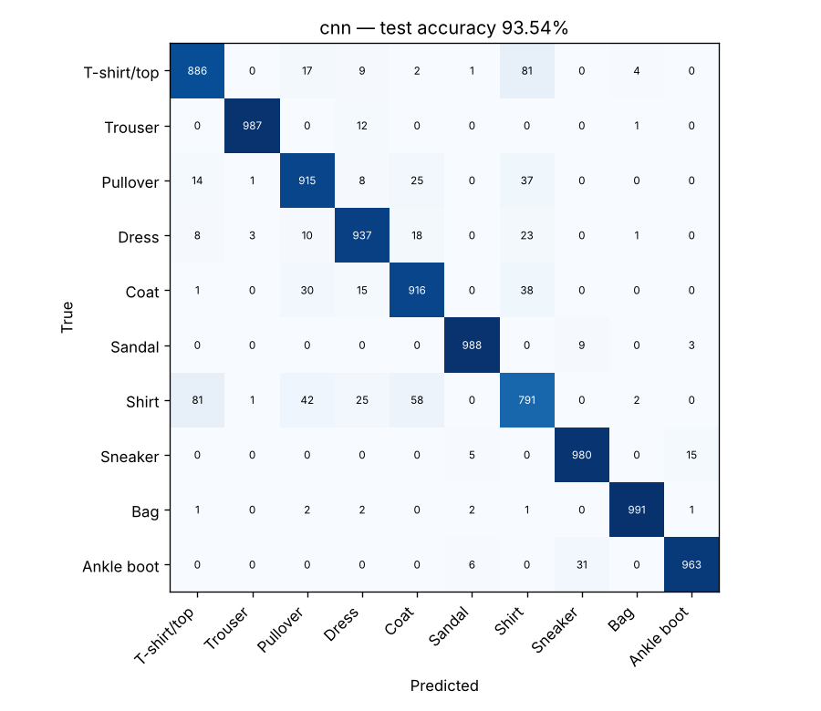

# Fashion-MNIST: from softmax regression to a CNN

[](https://github.com/santoshmyakala/fashion-mnist-neural-networks/actions/workflows/ci.yml)


Image classification on **Fashion-MNIST**: 70,000 greyscale 28×28 images of clothing in 10 classes. Three models of increasing capacity are trained with the same pipeline, so the comparison shows what each modelling step actually buys:

| Model | Parameters | Test accuracy | Training time (CPU) |
|---|---:|---:|---:|
| Softmax regression (linear) | 7,850 | **84.1%** | 7 s |
| MLP — 2 hidden layers, BatchNorm, dropout | 537,354 | **90.6%** | 97 s |
| CNN — 2 VGG-style conv blocks, augmentation | 870,826 | **93.5%** | 21 min* |

All three were trained for 15 epochs with seed 42 and evaluated on the official 10,000-image test set, which is never used for model selection. Checkpoints are picked by accuracy on a 6,000-image validation split carved from the training set.
<sub>*CNN time is on 2 CPU threads shared with other jobs; expect a few minutes on a GPU or an idle multi-core machine.</sub>

> I first did neural-network image classification during my PG Diploma in Machine Learning (Imarticus Learning). That code wasn't kept, so this is a fresh implementation in PyTorch.

## What the results show

```
                Softmax   MLP     CNN
T-shirt/top      81.6%   88.3%   88.6%
Trouser          95.6%   98.2%   98.7%
Pullover         73.3%   84.2%   91.5%
Dress            85.8%   91.4%   93.7%
Coat             78.0%   85.4%   91.6%
Sandal           90.6%   96.4%   98.8%
Shirt            55.5%   71.0%   79.1%
Sneaker          94.3%   96.6%   98.0%
Bag              93.3%   97.8%   99.1%
Ankle boot       93.2%   96.6%   96.3%
```

- The linear model already separates shape-distinct classes (trousers, bags, footwear). It struggles with upper-body garments, which differ mainly in texture and local detail.
- Convolutions help most where local structure matters: **Pullover +7.3 pts, Coat +6.2 pts, Shirt +8.1 pts** over the MLP.
- **Shirt** remains the hardest class even for the CNN. Its errors go to T-shirt/top (81), Coat (58) and Pullover (42). These are genuinely ambiguous at 28×28.



## Pipeline

<picture>
  <source media="(prefers-color-scheme: dark)" srcset="docs/diagrams/pipeline-dark.svg">
  
</picture>

<sub>Animated diagram generated from <a href="docs/diagrams">docs/diagrams/*.yaml</a> with <a href="https://github.com/santoshmyakala/santoshmyakala/tree/main/tools/archdiagram">archdiagram</a>.</sub>

## Quick start

```bash
git clone https://github.com/santoshmyakala/fashion-mnist-neural-networks.git
cd fashion-mnist-neural-networks
python -m venv .venv && source .venv/bin/activate
pip install torch --index-url https://download.pytorch.org/whl/cpu   # or a CUDA build
pip install -e ".[dev,track]"
```

Train a model. The data downloads and checksum-verifies on the first run.

```bash
python -m fmnist.train --model cnn --epochs 15 --mlflow
```

Options: `--model {softmax,mlp,cnn}`, `--epochs`, `--lr`, `--batch-size`, `--[no-]augment`, `--limit N` (subset for smoke tests), `--threads`, `--seed`.

Classify your own images. The trained weights for all three models are in `reports/`.

```bash
python -m fmnist.predict --model cnn examples/*.png
```

Actual output:

```
examples/test0_ankle-boot.png: Ankle boot (97.6%)
examples/test1_pullover.png: Pullover (98.1%)
examples/test2_trouser.png: Trouser (96.9%)
examples/test3_trouser.png: Trouser (94.9%)
examples/test4_shirt.png: Shirt (68.5%)
examples/test5_trouser.png: Trouser (96.7%)
```

Fashion-MNIST items are light on a dark background. Add `--invert` for photos of dark items on a light background.

Browse the experiment tracking:

```bash
mlflow ui --backend-store-uri sqlite:///mlflow.db
```

## Testing

```bash
pytest -q
```

The 10 tests cover:
- the IDX parser: round-trip, truncated payloads and wrong data types are rejected;
- output shapes for every model;
- an **overfit-a-tiny-batch** check per model, a standard test that gradients flow end to end;
- augmentation keeping image shape.

CI also smoke-trains every model on a 5,000-image subset, which exercises the real download and checksum path.

## Design choices

- **No torchvision dependency.** The IDX format takes a 20-line parser, and checksums guard the download. This keeps the install small and the data path explicit.
- **Validation split for model selection; test set touched once.** This avoids the common mistake of reporting the best test-set epoch.
- **OneCycle LR + AdamW + label smoothing** give strong results in 15 epochs without tuning.
- **Augmentation only for the CNN.** Flips and small shifts suit translation-equivariant models. The MLP and softmax baselines are trained on raw pixels so the comparison stays about architecture.

## Roadmap

- [ ] ResNet-style residual blocks and mixed-precision training on GPU.
- [ ] Export to ONNX and serve with a FastAPI endpoint (see my [wine-quality-mlops](https://github.com/santoshmyakala/wine-quality-mlops) repo for the serving pattern).
- [ ] Grad-CAM visualisations for the Shirt / T-shirt confusions.

## Licence and attribution

Code: MIT. Fashion-MNIST © Zalando SE, MIT licence — Xiao, Rasul & Vollgraf, *Fashion-MNIST: a Novel Image Dataset for Benchmarking Machine Learning Algorithms*, arXiv:1708.07747 (2017).
